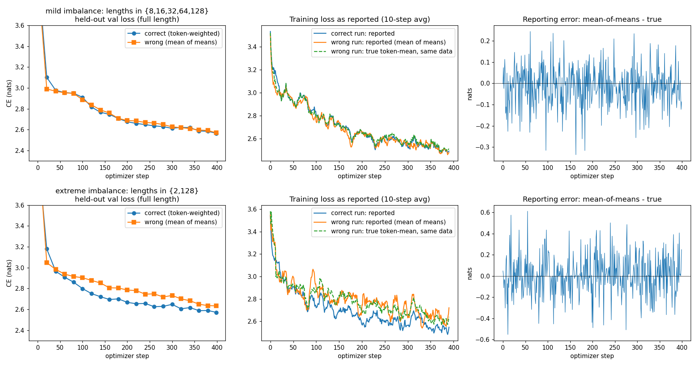
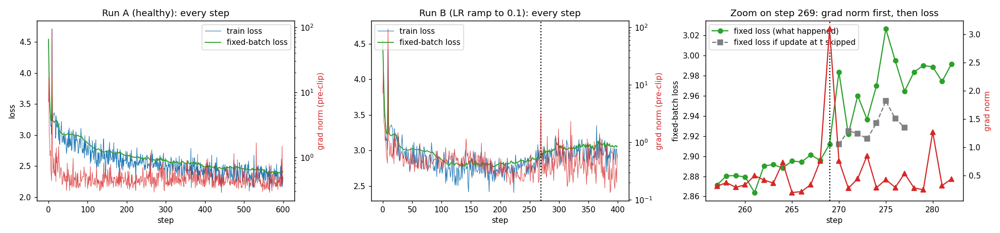

# Making a small model tell the truth about itself

A 4-layer, 0.83 M-parameter char-level GPT (C=128, 4 heads) trained on 3 MB of Python stdlib source, instrumented six ways.
Everything here was produced by [`training_truth.ipynb`](training_truth.ipynb) (executed, outputs saved). The same code lives in [`lab.py`](lab.py); `build_nb.py` turns it into the notebook. Raw numbers are in [`results.json`](results.json).

Hardware: NVIDIA RTX 3060 Laptop (6 GB), PyTorch 2.10 + CUDA 12.6, Windows. Numbers will differ on your machine; the *conclusions* should not.

```bash
pip install -r requirements.txt
jupyter nbconvert --to notebook --execute --inplace training_truth.ipynb   # ~4 min on a laptop GPU
```

---

## 1. Every tensor shape in one step

`B`=16 batch (independent sequences) · `T`=128 token position (causal order) · `C`=128 d_model (residual stream width) · `H`=4 heads · `D`=32 head dim (C/H) · `V`=96 vocab (one logit per character) · `4C`=512 MLP hidden width.

| tensor | shape | dims mean |
|---|---|---|
| `idx`, `targets` (int64) | (16, 128) | B,T: char ids / next-char ids |
| `wte(idx)+wpe(pos)` | (16, 128, 128) | B,T,C |
| `ln1 out`, `heads re-merged`, `residual`, `mlp out`, `final LN` | (16, 128, 128) | B,T,C |
| `qkv = Linear(C→3C)` | (16, 128, 384) | B,T,3C: q,k,v stacked |
| `q`, `k`, `v`, `attn out` | (16, 4, 128, 32) | B,H,T,D: one head's view of each position |
| `mlp hidden = Linear(C→4C)` | (16, 128, 512) | B,T,4C |
| `logits` | (16, 128, 96) | B,T,V: score of each possible next char |
| `loss` | () | mean over B·T = 2048 token terms |
| `wte.weight` / `lm_head.weight` | (96, 128) | V,C |
| `wpe.weight` | (128, 128) | T,C: one row per position |
| `qkv.weight` / `fc.weight` / `out.weight` / `proj.weight` | (384,128) / (512,128) / (128,512) / (128,128) | out-features × in-features |
| LN `weight`/`bias` | (128,) | C |
| every `.grad`, AdamW `exp_avg`, `exp_avg_sq` | same as the parameter | |

The notebook prints the full trace (block 0 shown, blocks 1–3 are identical) plus one line per parameter with its grad and optimizer-state shape.

## 2. One gradient verified by hand

Central difference `(L(w+ε) − L(w−ε))/2ε` vs `p.grad` from `backward()`, 5 weights across the network (qkv, MLP up/down, lm_head, embedding), fixed batch.

| dtype, ε | worst relative error | example (`blocks.0.qkv.weight[5,7]`) backward / finite-diff |
|---|---|---|
| float64, 1e-6 | **7e-8** | −0.00383845 / −0.00383845 |
| float32, 1e-2 | 6e-3 | −0.00383829 / −0.00381470 |
| float32, 1e-4 | **4.6e-1** | −0.00383829 / −0.00715256 |

float64 agrees to 7–8 significant digits. float32 does *not* agree to several decimals, and shrinking ε makes it worse, not better: the loss is stored to ~7 digits, so `L(w+ε) − L(w−ε)` at ε=1e-4 is a subtraction of nearly equal numbers and rounding noise divided by 2ε swamps the signal (cancellation error ~ u/ε; truncation error ~ ε²). The thing that disagrees is the fp32 finite difference, not `backward()`: the fp32 `backward()` value (−0.00383829) matches the float64 one (−0.00383845) to ~4 digits.

## 3. Gradient accumulation broken on purpose

One optimizer step = 4 micro-batches × 8 sequences, each micro-batch with a *different sequence length*.
* **right**: Σ token CE / total tokens in the step (sanity-checked: equals one big padded batch with `ignore_index`, max grad difference 9e-8).
* **wrong**: mean over micro-batches of each micro-batch's mean (a token in an *n_k*-token micro-batch weighs 1/(4·n_k)).

Same init, same data stream, same AdamW, 400 steps, evaluated on the same held-out full-length batches:

| scenario | val loss right | val loss wrong | gap | mean abs error of the *reported* train loss |
|---|---|---|---|---|
| mild: lengths ∈ {8,16,32,64,128} | 2.5644 | 2.5689 | +0.005 | 0.071 nats (max 0.34) |
| extreme: lengths ∈ {2,128} | 2.5709 | 2.6333 | **+0.063** | 0.134 nats (max 0.61) |



Honest reading: with mild imbalance the damage is small — AdamW normalises gradient scale, and one-step gradient cosine(right, wrong) was 0.993 — but the *reported* loss is already noisy by ~0.07 nats in a direction that depends on which lengths you drew. With extreme imbalance the wrong estimator over-weights the 2-token micro-batches 64× per token, trains toward early positions, and is visibly worse on full-length text for the whole run (the middle panel's orange line sits above the blue one; the dashed green line shows the true token-mean loss of that same run).

## 4. Grad norm every step; a step where it moved before the loss

Per step I log train-batch loss, pre-clip grad norm, and the loss on one **fixed held-out batch** (evaluated before the step's update). Train-batch loss alone is dominated by which batch you drew (±0.15), so it can't show the effect of a single update.

"Moved before" = grad norm > 2× its trailing-20 median at step *t* while the fixed-batch loss at *t* is flat, then the loss is higher at *t+1*. Because that is only a correlation, I snapshot model + optimizer + data RNG at *t* and branch: apply the update vs. skip it, same batches afterwards.



**Run B** (same model, LR ramped 3e-3 → 0.1 over steps 100–400 to push it toward instability). Step 269:

| step | train loss | fixed loss | grad norm |
|---|---|---|---|
| 268 | 2.8028 | 2.8958 | 0.756 |
| **269** | 2.8269 | **2.9120** | **3.092** (9× median) |
| 270 | 2.8345 | **2.9836** | 0.760 |

At 269 the grad norm is 9× its median while neither loss has moved; the fixed loss jumps +0.07 on the next step. Skipping the update at 269 keeps the fixed loss at 2.9120 → the big gradient caused the jump (damage@t+1 = +0.072; it is still +0.019 four steps later).

**Control, and a false positive I want to flag.** The same detector on the healthy run A (lr 3e-3) found four spikes (up to 4× median); skip-vs-update damage was −0.008…+0.015, i.e. nothing. Likewise 3 of the 4 candidates in run B showed no damage. Earlier, using train-batch loss, my detector picked a step (524) where loss rose 0.5 right after a gradient spike — replaying with the update skipped gave the same rise, so that was just a hard batch. **A grad-norm spike is necessary-looking but not sufficient evidence of trouble; the counterfactual is what separates them.**

(Not shown in the figure: the very first steps are wild — step 9 of a plain lr=3e-3 run has grad norm 94 with train loss 4.7, simultaneously — that is an early-training transient, not a lead.)

## 5. MFU

`MFU = tokens/s × FLOPs/token ÷ peak`, `FLOPs/token = 6·N_matmul + 12·L·C·T` (PaLM/nanoGPT convention: 2 fwd + 4 bwd per matmul weight; attention QKᵀ and AV; causal mask not discounted; embeddings/LN not counted).
Peak: 30 SMs × 512 FLOP/clk/SM (GeForce Ampere bf16, fp32-accumulate, dense) × 2100 MHz max clock = **32.3 TFLOP/s**. A big 4096³ bf16 matmul sustains **20.9–25.2 TFLOP/s** here (65–78 % of that; laptop power/thermal limits), so that is the realistic ceiling.

| config (bf16 autocast unless noted) | ms/step | tokens/s | TFLOP/s | MFU |
|---|---|---|---|---|
| **lab model** C=128, L=4, B=16, T=128 | 30.9 | 66 k | 0.37 | **1.1 %** |
| lab model, fp32 | 17.1 | 120 k | 0.67 | 2.1 % |
| lab model, B=128 | 19.2 | 855 k | 4.77 | 14.8 % |
| medium C=512, L=8, B=16, T=256 | 50.6 | 81 k | 13.3 | 41.1 % |
| medium, B=32 | 89.3 | 92 k | 15.0 | 46.6 % |

(Run-to-run variation on a laptop GPU is large for the tiny model: 1.1–1.6 % across my runs.)

**The honest headline: the model I actually trained gets ~1–2 % MFU, nowhere near 40 %.** What costs the distance, in order of evidence:
1. **It is launch/overhead-bound, not compute-bound.** fp32 is *faster* than bf16 (17 vs 31 ms: autocast adds cast kernels); 8× more tokens (B=128) costs only ~1.1× the time. A step is ~17–30 ms of fixed cost — hundreds of tiny kernels (4 layers × LN/qkv/SDPA/GELU/… fwd+bwd, plus AdamW and grad-clip) each doing microseconds of work with Python dispatch in between. The matmuls are 128-wide; tensor cores can't fill.
2. Remedies I did not apply: batch/model large enough to be matmul-dominated (medium config reaches 41–47 %), CUDA graphs / `torch.compile` (Triton isn't available on this Windows setup), fused AdamW, fused LN/GELU.
3. For the medium model, 41–47 % is against the *nominal* 2100 MHz peak; against the measured matmul ceiling (~21 TFLOP/s) it is ~63–72 %. I wouldn't claim "beat 40 %" without noting that my peak is a spec calculation on a power-limited laptop part and that the FLOP convention counts the full (non-causal) attention square. What remains below the matmul ceiling there: unfused elementwise ops (LN, GELU, residual adds, softmax around SDPA), the 96-wide `lm_head`, fp32 optimizer + clip, memory-bound ops.

## 6. The number 0.1 by hand

0.1 = 1.6 × 2⁻⁴. Mantissa of 1.6, i.e. 0.6 in binary: 0.6×2=1.2→1, 0.2×2=0.4→0, 0.4×2=0.8→0, 0.8×2=1.6→1, 0.6→1 … repeats: `.1001 1001 1001 …` — never terminates, so 0.1 is inexact in every binary format.

| format | layout | exponent | mantissa (rounded) | bits | hex | value | rel. error |
|---|---|---|---|---|---|---|---|
| fp32 | 1 / 8 (bias 127) / 23 | −4+127 = 123 = `01111011` | `10011001100110011001100` + next bits `1 1001…` > ½ → round up → `…101` | `0 01111011 10011001100110011001101` | `0x3DCCCCCD` | 0.100000001490116… | 1.5e-8 |
| bf16 | 1 / 8 (127) / 7 | `01111011` | `1001100` + `1…` → round up → `1001101` | `0 01111011 1001101` | `0x3DCD` | 0.10009765625 | 9.8e-4 |
| fp8 E4M3 | 1 / 4 (7) / 3 | −4+7 = 3 = `0011` | `100` + `1…` → round up → `101` | `0 0011 101` | `0x1D` | 0.1015625 | 1.6e-2 |

The notebook re-derives these with a hand-written round-to-nearest-even encoder and checks that every bit pattern equals PyTorch's own cast (all three: `True`).

**What I would train in: bf16 compute with fp32 master weights, fp32 optimizer state, and fp32 for softmax/LN statistics/loss reduction.**
* bf16 has the *same exponent range as fp32* (max ≈3.4e38), so no loss scaling and no overflow/underflow babysitting; gradients span many orders of magnitude and this matters more than precision.
* Its 8-bit mantissa (error ~1e-3 on 0.1) is below the noise of a minibatch gradient, so matmul inputs lose nothing that SGD wasn't already losing — but accumulation and weight updates must stay fp32: an update of `lr·Δ ≈ 1e-5` on a weight of 0.1 is far below bf16's resolution (~4e-4) and would be silently rounded away.
* fp8 E4M3 has 1.6 % error on this one number, max value 448, and a tiny exponent range: it only works with per-tensor (or per-block) scaling and amax tracking, for matmul inputs on hardware with fp8 tensor cores (Hopper/Ada+; my Ampere GPU has none). I'd consider it only for a large model where the 2× matmul throughput pays for the extra scaling machinery and instability risk, with bf16 kept for sensitive layers (embeddings, lm_head, norms) — not for a 0.8 M-parameter model.

---

## Files
| file | what |
|---|---|
| `training_truth.ipynb` | executed notebook, all outputs and plots |
| `lab.py` | source of the notebook (`# %%` cells) |
| `build_nb.py` | `lab.py` → notebook |
| `results.json` | raw numbers quoted above |
| `figs/` | `accumulation.png`, `gradnorm.png` |
